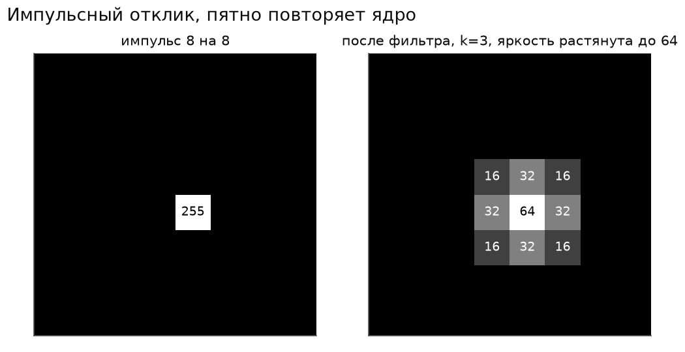
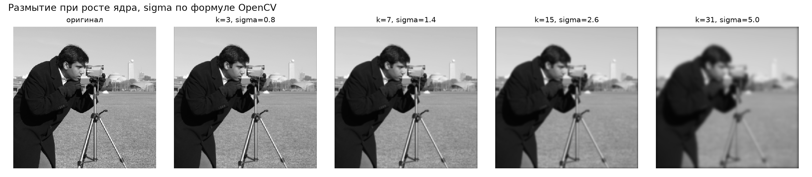
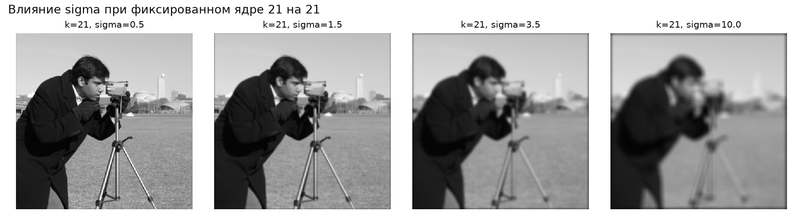
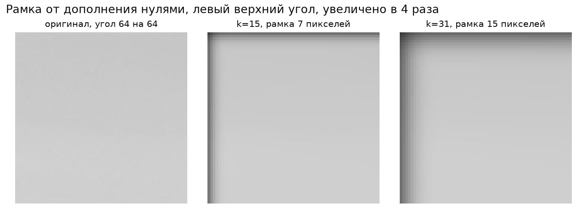
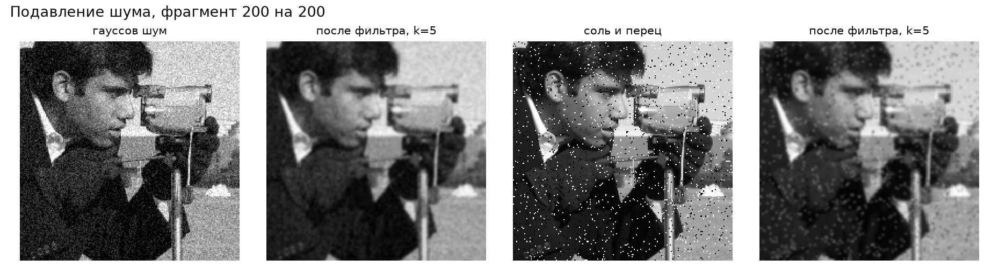
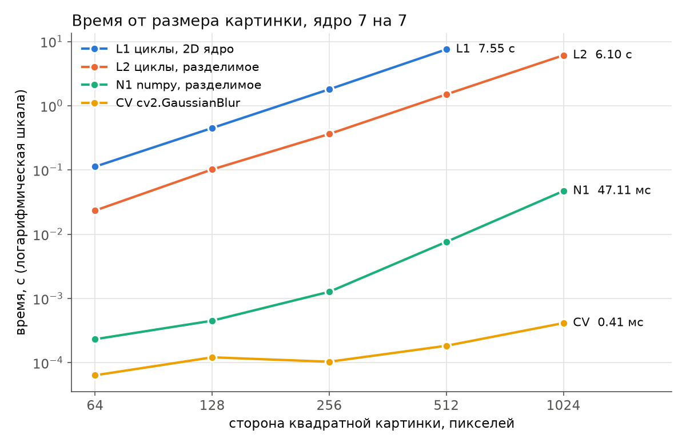
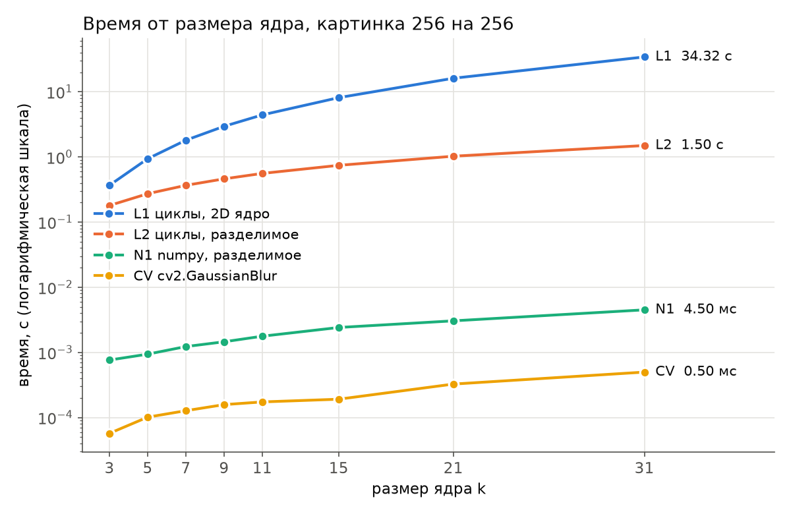

# ЛР1. Фильтр Гаусса

Вариант 3 – усредняющий фильтр Гаусса с переменным размером ядра и параметрами гауссианы.

Фильтр реализован четырьмя способами:

| Обозначение | Реализация | Что показывает |
|---|---|---|
| L1 | циклы Python, двумерное ядро | нативная версия, точка отсчета |
| L2 | циклы Python, разделимое ядро | выигрыш от алгоритма |
| N1 | numpy, разделимое ядро | выигрыш от векторизации |
| CV | `cv2.GaussianBlur` | библиотечная версия, потолок по скорости |

Нативной реализацией в смысле условия считаются L1 и L2 – в них каждое умножение и сложение свертки выполняет собственный код на Python, а numpy используется только для хранения массивов. N1 передает арифметику numpy и поэтому выделена в отдельную ступень между нативным кодом и библиотекой.

---

## 1. Теоретическая база

### 1.1. Изображение и фильтр

Серое изображение – это двумерный массив целых чисел от 0 до 255, где 0 соответствует черному, 255 белому. Фильтр заменяет каждый пиксель смесью его самого и соседей. Таблица весов, с которыми соседи входят в смесь, называется ядром.

Операция, при которой ядро прикладывают центром к каждому пикселю, перемножают веса с числами под ними и складывают произведения, называется сверткой. Результат пишется в новый массив, а читается всегда исходный.

```
out[i, j] = Σ Σ kernel[a, b] · img[i + a − r, j + b − r]
            a b
```

Здесь `k` – размер ядра, `r = (k − 1) / 2` – его радиус, `a` и `b` пробегают от 0 до `k − 1`.

### 1.2. Гауссово ядро

Вес клетки ядра зависит только от ее смещения `(x, y)` относительно центра.

```
G(x, y) = exp( −(x² + y²) / (2 · sigma²) )
```

В центре смещение нулевое и вес максимален. С удалением от центра вес падает по колоколу. Ближние соседи влияют сильнее дальних, поэтому, в отличие от простого усреднения, гауссово размытие выглядит естественно для глаза – это модель расфокусированного объектива.

Ядро строится в три шага. Значения формулы берутся в целых точках от `−r` до `+r` по обеим осям, затем все веса делятся на их сумму. Нормировка нужна, чтобы сумма весов была равна 1 и общая яркость картинки не менялась. Множитель `1 / (2π · sigma²)` из полной формулы гауссианы опускается – он одинаков для всех клеток и сокращается при нормировке.

Размер ядра обязан быть нечетным, иначе у ядра нет центральной клетки и результат сдвигается на полпикселя. Функция построения ядра отвергает четный размер с ошибкой.

Для `k = 3` и `sigma ≈ 0.849` ядро совпадает с биномиальным.

```
        1  2  1
1/16 ·  2  4  2
        1  2  1
```

Это значение sigma выводится из требования, чтобы сосед по стороне весил вдвое меньше центра, `exp(−1 / (2 · sigma²)) = 0.5`, откуда `sigma = 1 / sqrt(2 · ln 2) ≈ 0.849322`. В работе оно использовано как контрольная точка для проверки функции ядра.

### 1.3. Параметры k и sigma

Sigma задает ширину колокола, то есть силу размытия. Размер ядра задает, сколько соседей вообще участвует. Параметры нужно согласовывать. Если ядро слишком мало для своей sigma, колокол обрезается там, где веса еще значительны, и фильтр вырождается в простое усреднение. Если ядро слишком велико, на краях оказываются почти нулевые веса, и время тратится впустую.

На расстоянии `3 · sigma` от центра остается меньше процента веса, отсюда практическое правило `k ≈ 6 · sigma + 1`. Когда нужно задать sigma по размеру ядра, в работе используется формула OpenCV.

```
sigma = 0.3 · ((k − 1) · 0.5 − 1) + 0.8
```

### 1.4. Краевые условия

У пикселей на границе часть ядра выходит за пределы изображения. Данных там нет, и их приходится чем-то заполнять.

В работе за границей изображения подставляются нули, `BORDER_CONSTANT`. Его следствие – темная рамка шириной `r` по периметру, в углах темнее, чем по сторонам. На сплошном белом листе с ядром 3 угловой пиксель становится 143, а боковой 191 вместо 255. Это свойство способа, а не дефект реализации, оно показано в разделе 3.

### 1.5. Разделимость

Экспонента суммы равна произведению экспонент.

```
exp( −(x² + y²) / 2σ² ) = exp( −x² / 2σ² ) · exp( −y² / 2σ² )
```

Значит двумерное гауссово ядро – это произведение одномерного ряда на самого себя, и свертку с ним можно провести в два прохода. Сначала каждая строка размывается одномерным ядром по горизонтали, затем результат размывается по вертикали. Итог совпадает с двумерной сверткой точно, а число умножений на пиксель падает с `k²` до `2k`.

| k | двумерная, `k²` | разделимая, `2k` | выигрыш |
|---|---|---|---|
| 3 | 9 | 6 | 1.5 |
| 15 | 225 | 30 | 7.5 |
| 31 | 961 | 62 | 15.5 |

### 1.6. Векторизация

Цикл в Python медленный не из-за умножения, а из-за накладных расходов интерпретатора на каждом обороте. Numpy выполняет одну операцию над целым массивом скомпилированным кодом. Если поменять порядок циклов и для каждой клетки ядра обрабатывать сразу всю картинку, циклы по пикселям исчезают. Сдвинутый срез дополненной картинки содержит на месте каждого пикселя его соседа с одним и тем же номером, поэтому свертка сводится к `k` умножениям среза на вес и `k` сложениям для каждого прохода.

### 1.7. Типы данных и округление

`uint8` при переполнении заворачивается по кругу, 250 + 10 дает 4. Поэтому все промежуточные вычисления ведутся в `float64`, а в `uint8` результат переводится один раз в конце в порядке ограничение диапазоном, округление, смена типа. Смена типа без округления отбрасывает дробную часть и систематически занижает значения.

---

## 2. Описание разработанной системы

### 2.1. Структура

```
lab1/
├── README.md
├── pyproject.toml, uv.lock   окружение uv
├── .gitignore
├── src/
│   ├── gauss.py              функции фильтра
│   ├── run.py                прогоны всех реализаций, запись в results/
│   ├── compare.py            попиксельная сверка реализаций
│   ├── bench.py              замеры времени, results/bench.csv
│   └── plots.py              графики и иллюстрации, results/plots/
├── data/                     тестовые изображения, одной папкой
├── results/
│   ├── L1/ L2/ N1/ CV/       результаты каждой реализации
│   ├── plots/                графики для отчета
│   └── bench.csv             сырые замеры, создается bench.py, в git не хранится
```

### 2.2. Функции в `src/gauss.py`

| Функция | Что делает |
|---|---|
| `calculate_gaussian_kernel(k, sigma)` | двумерное нормированное ядро `k × k` |
| `calculate_gaussian_kernel_1d(k, sigma)` | одномерное нормированное ядро длиной `k` |
| `convolution(img, k, sigma)` | L1, четыре вложенных цикла |
| `convolution_separable(img, k, sigma)` | L2, два прохода по три цикла |
| `convolution_numpy(img, k, sigma)` | N1, два прохода срезами numpy |

Все три свертки принимают серое изображение `uint8`, размер ядра и sigma, и возвращают `uint8` того же размера.

### 2.3. Алгоритмы

**Ядро.** Смещение клетки от центра – номер клетки минус радиус, вес по формуле из 1.2, в конце деление на сумму.

**L1.** Рамка нулей толщиной `r` со всех сторон. Два цикла по пикселям, два по клеткам ядра, клетка `[a, b]` берет число `pad[i + a, j + b]`.

**L2.** Два прохода одним одномерным ядром. Горизонтальный – рамка по бокам, сдвиг по столбцам, результат в промежуточный `float64`. Вертикальный – рамка сверху и снизу вокруг промежуточного, сдвиг по строкам.

**N1.** Те же два прохода, но цикл только по клеткам ядра. На каждом обороте сдвинутый срез размером с картинку умножается на вес и прибавляется к накопителю.

**CV.** `cv2.GaussianBlur` с теми же `k` и sigma, края нулями через `borderType=cv2.BORDER_CONSTANT`.

### 2.4. Тестовый набор

Лежит в `data/` готовым. Фотография камерамена взята из встроенного набора `scikit-image`, импульс и градиент синтезированы, шум добавлен с фиксированным seed. Серия для замеров получена уменьшением снимка `retina` из того же набора методом `INTER_AREA`.

| Файлы | Что это | Назначение |
|---|---|---|
| `impulse_8x8.png` | один белый пиксель на черном поле | проверка корректности, ответ известен заранее |
| `gradient_128.png` | плавный горизонтальный градиент | проверка, что ровные участки не меняются, и наглядная рамка |
| `camera_512.png` | камерамен 512 × 512 | иллюстрации на реальном снимке |
| `camera_gauss.png`, `camera_saltpepper.png` | камерамен с гауссовым шумом и с шумом соль и перец | демонстрация подавления шума |
| `bench_64.png` … `bench_1024.png` | одно изображение в пяти размерах | замеры времени с одинаковым содержимым |

### 2.5. Методика замеров

- Измеряется только вызов свертки, чтение и запись файлов в замер не входят.
- Быстрые реализации, N1 и CV, запускаются один раз вхолостую для прогрева, затем 21 раз. Медленные, L1 и L2, запускаются 3 раза без прогрева – их время измеряется секундами, и разовые эффекты в нем тонут.
- В результат идет медиана, а не среднее, чтобы один случайный медленный запуск не искажал значение.
- Sigma для каждого размера ядра считается по формуле OpenCV из раздела 1.3.
- L1 на картинке 1024 не измерялся, один запуск занимал бы около 30 секунд.
- Замеры проводились на одном компьютере с процессором x86-64. OpenCV по умолчанию считает в 8 потоков, все свои реализации однопоточные. Версии библиотек зафиксированы в `uv.lock`.


---

## 3. Результаты работы и тестирования

### 3.1. Корректность ядра

Функция ядра проверена на четырех свойствах – сумма весов равна 1, ядро симметрично по обеим осям, максимум в центре, четный размер отвергается. Контрольная точка `k = 3`, `sigma = 0.849322`, умноженная на 16, дает в точности таблицу 1, 2, 1 / 2, 4, 2 / 1, 2, 1. Одномерное ядро совпадает с `cv2.getGaussianKernel` при явной sigma с расхождением порядка `1e-17`.

### 3.2. Импульсный отклик

Одиночный белый пиксель на черном поле – самый информативный тест. Вокруг него все нули, поэтому каждый выходной пиксель получает ровно один вес, умноженный на 255, и пятно на выходе повторяет само ядро. Сумма пятна 256, то есть исходные 255 плюс округление.



Все четыре реализации на импульсе совпадают побитово.

### 3.3. Сверка реализаций

Сравнение по карте модуля разности. Для каждой пары считается максимальное расхождение, среднее расхождение и доля отличающихся пикселей. Скрипт `compare.py`.

| Пара | impulse k3 | gradient k3 | camera k3 | camera k15 |
|---|---|---|---|---|
| L2 против L1 | равны | равны | равны | равны |
| N1 против L1 | равны | равны | равны | равны |
| L1 против CV | равны | макс 1, 0.90 % | макс 1, 1.00 % | макс 1, 2.27 % |

Три свои реализации совпадают между собой побитово на всех изображениях.
Принятый допуск – расхождение с OpenCV на `uint8` не больше 1, своих реализаций между собой – полное совпадение.

### 3.4. Влияние параметров

С ростом ядра и sigma по формуле OpenCV размытие нарастает. При `k = 3` изображение почти не меняется, при `k = 31` пропадают все мелкие детали.



При фиксированном ядре 21 влияние sigma сильнее, чем влияние размера. При `sigma = 0.5` ядро фактически 3 на 3, остальные веса практически нулевые и считаются впустую. При `sigma = 10` колокол шире окна, правило трех сигм нарушено, и фильтр работает почти как простое усреднение по квадрату.



### 3.5. Краевые условия

Дополнение нулями дает темную рамку шириной `r`. На ядре 15 видны 7 полос, на ядре 31 – 15, яркость полос падает к краю.



### 3.6. Подавление шума

Гауссов шум портит все пиксели понемногу, и усреднение с соседями его эффективно гасит. Импульсный шум соль и перец фильтр Гаусса не убирает, а размазывает каждую точку в серое пятно.



### 3.7. Быстродействие

Время от размера картинки при ядре 7.



| Сторона | L1 | L2 | N1 | CV |
|---|---|---|---|---|
| 64 | 0.113 с | 0.023 с | 0.23 мс | 0.06 мс |
| 128 | 0.451 с | 0.102 с | 0.45 мс | 0.12 мс |
| 256 | 1.80 с | 0.364 с | 1.27 мс | 0.10 мс |
| 512 | 7.55 с | 1.50 с | 7.61 мс | 0.18 мс |
| 1024 | – | 6.10 с | 47.1 мс | 0.41 мс |

Время от размера ядра на картинке 256 на 256.



| k | L1 | L2 | N1 | CV |
|---|---|---|---|---|
| 3 | 0.367 с | 0.180 с | 0.76 мс | 0.06 мс |
| 7 | 1.81 с | 0.367 с | 1.23 мс | 0.13 мс |
| 15 | 8.14 с | 0.744 с | 2.41 мс | 0.19 мс |
| 31 | 34.3 с | 1.50 с | 4.50 мс | 0.50 мс |

Ускорения на картинке 512 с ядром 7.

| Переход | Ускорение | За счет чего |
|---|---|---|
| L1 → L2 | ~5 раз | разделимое ядро, `2k` вместо `k²` операций |
| L2 → N1 | ~200 раз | numpy вместо интерпретатора |
| N1 → CV | ~40 раз | многопоточность, целочисленная арифметика, отсутствие временных массивов |
| L1 → CV | ~41 000 раз | все вместе |

### 3.8. Закономерности

**Время пропорционально числу пикселей.** У L1 и L2 удвоение стороны картинки дает рост времени почти ровно в 4 раза. На логарифмическом графике это параллельные прямые.

**L1 растет как квадрат ядра, L2 линейно.** При росте ядра с 3 до 31, примерно в 10 раз, L1 замедлился в 93 раза, близко к теоретическим 107, а L2 в 8.3 раза, близко к 10. Это прямое измерение разницы между `k²` и `2k`.

**Реальный выигрыш L2 больше теоретического.** На ядре 7 теория дает 49 / 14 = 3.5 раза, измерено 5. В Python дорого не только умножение, но и каждый оборот цикла, а у L2 их меньше в той же пропорции.

**У быстрых реализаций закономерности искажаются.** CV на маленьких картинках почти не зависит от размера – время уходит на сам вызов и распределение работы по потокам. N1 при переходе от 512 к 1024 замедляется не в 4, а в 6 раз – массив `float64` в 8 МБ перестает помещаться в кеш процессора, а numpy на каждой операции создает новый временный массив и прогоняет его через основную память.

**Разрыв N1 и CV раскладывается на три причины.** Отдельный замер на картинке 512 показал, что без многопоточности OpenCV медленнее в 2–2.5 раза, а на входе `float64` еще в 4–7 раз. Оставшийся разрыв, около 5 раз, – цена временных массивов numpy, которые OpenCV не создает.

---

## 4. Выводы

1. Три собственные реализации совпадают между собой побитово, а с OpenCV расходятся не больше чем на 1 из-за его целочисленной арифметики на `uint8`.
2. Дополнение нулями дает темную рамку по периметру шириной в радиус ядра.
3. Размер ядра и sigma нужно согласовывать, иначе фильтр либо вырождается в простое усреднение, либо тратит время на нулевые веса.
4. Фильтр хорошо подавляет гауссов шум и лишь размазывает импульсный.
5. Разделимость ядра снижает число операций на пиксель с `k²` до `2k`.
6. Векторизация на numpy дает ускорение за счет отказа от циклов интерпретатора.
7. OpenCV быстрее за счет многопоточности, целочисленной арифметики и отсутствия временных массивов.
8. Абсолютное время зависит от машины, а форма зависимостей и порядок ускорений – нет.

---

## 5. Использованные источники

1. OpenCV: `Blur, Kernal, Border`. https://docs.opencv.org/5.0/main_modules/imgproc_filter.html
2. NumPy: `.pad`. https://numpy.org/doc/2.5/reference/generated/numpy.pad.html
3. Изображения из работы: `skimage.data`. https://scikit-image.org/docs/0.26.x/api/skimage.data.html
