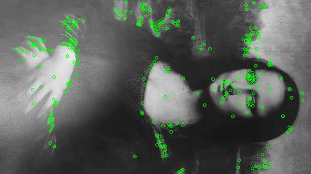
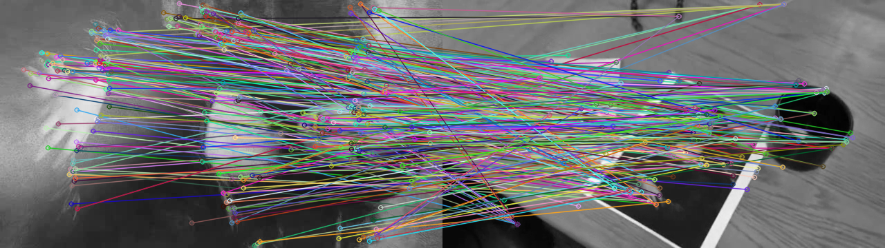
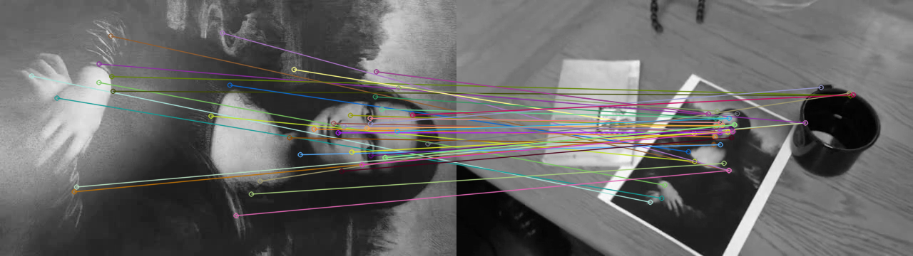
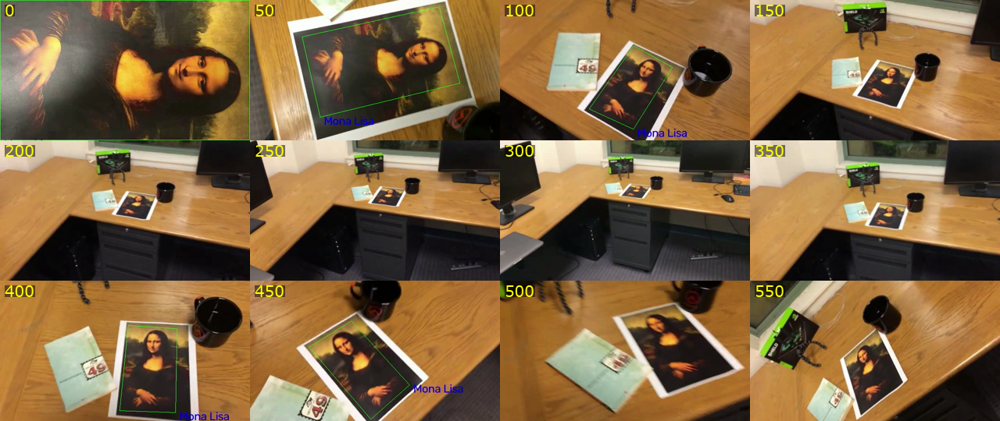
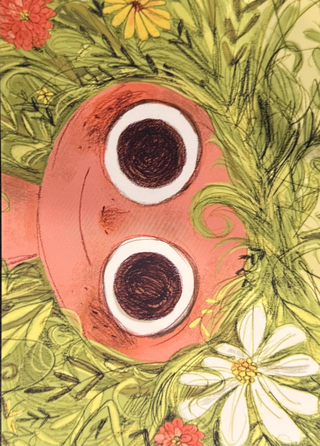
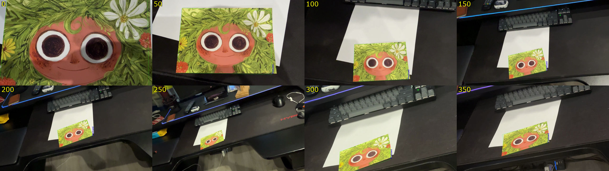

# ЛР2. Трекинг объекта по ключевым точкам

Программа принимает видео, первый кадр которого – крупное изображение плоского объекта, и на каждом кадре, где объект виден, рисует вокруг него рамку с подписью. Рамка – четырехугольник, который повторяет положение, поворот и наклон объекта.

Трекер реализован с двумя детекторами ключевых точек, SIFT и ORB, и проверен на трех тестовых видео из задания и на собственном видео.

---

## 1. Теоретическая база

Теория изложена в том порядке, в каком трекер обрабатывает видео.

### 1.1. Видео как последовательность кадров

Видео – это кадры, которые идут один за другим с частотой около 30 в секунду. Каждый кадр – цветное изображение, массив `высота × ширина × 3` типа `uint8`, каналы в OpenCV идут в порядке B, G, R. Видео читается кадр за кадром, пока кадры не кончатся, а результат записывается в новый файл с той же частотой и размером.

Первый кадр видео – крупное изображение объекта. Он служит эталоном, с которым сравнивается каждый следующий кадр.

### 1.2. Перевод в серый

Ключевые точки ищутся по перепадам яркости, цвет для этого не нужен. Поэтому эталон и каждый кадр переводятся в серый. Это втрое уменьшает объем данных и делает поиск устойчивее к смене освещения. Рамка при этом рисуется на исходном цветном кадре.

### 1.3. Ключевые точки

Ключевая точка – место изображения, которое можно однозначно найти снова на другом снимке того же объекта, даже если объект сдвинут, повернут, удален или иначе освещен.

Если сдвинуть маленькое окно на пару пикселей, то на ровном участке содержимое окна не изменится, на крае изменится только поперек края, а на углу или пятне – в любом направлении. Ключевые точки ищут в местах третьего типа.

```
E(u, v) = Σ [ I(x + u, y + v) − I(x, y) ]²
```

`I` – яркость, сумма по пикселям окна, `(u, v)` – сдвиг. Точка хорошая, если `E` велико при любом направлении сдвига. Важна разница яркостей, а не сама яркость – на ярком ровном участке точек нет.

На эталоне точки собираются на глазах, пальцах, складках и пейзаже, а на кадре со столом – еще и на фоне, на текстуре дерева, коробке и кружке. Чем меньше объект на кадре, тем меньше на нем точек, мелкие детали пропадают.

### 1.4. Дескрипторы

Дескриптор – числовое описание окрестности точки. Сама точка – только координаты, а по дескрипторам можно понять, что точка эталона и точка кадра – одно и то же место объекта.

| | SIFT | ORB |
|---|---|---|
| как ищет точки | пятна на нескольких уровнях гауссова размытия | углы детектором FAST – пиксель сравнивается с 16 соседями по кругу |
| дескриптор | 128 чисел – гистограммы направлений перепадов яркости вокруг точки | 256 бит – ответы «ярче или темнее» для пар пикселей |
| расстояние между дескрипторами | евклидово | Хэмминга, число несовпавших битов |

### 1.5. Сопоставление и тест Лоу

Для каждой точки эталона перебором ищутся две ближайшие по дескриптору точки кадра. Ближайшая находится всегда, даже если точки эталона на кадре нет, поэтому пару оставляют, только если лучший кандидат заметно ближе второго.

```
d₁ < 0.75 · d₂
```

Порог по самому расстоянию не работает. Расстояния у правильных и ложных пар перекрываются и зависят от размытия и масштаба, а отношение лучшего кандидата ко второму для одной точки от них почти не зависит.

### 1.6. Гомография

Плоский объект при съемке под любым углом переходит в кадр по закону гомографии – матрицы 3 × 3.

```
⎡x'⎤   ⎡h11 h12 h13⎤ ⎡x⎤
⎢y'⎥ = ⎢h21 h22 h23⎥ ⎢y⎥ ,   X = x' / w',  Y = y' / w'
⎣w'⎦   ⎣h31 h32  1 ⎦ ⎣1⎦
```

Правый столбец задает сдвиг, левый верхний квадрат – поворот, масштаб и наклон, нижняя строка – перспективу. У матрицы 8 неизвестных, каждая пара точек дает два уравнения, значит нужно минимум 4 пары.

Деление на `w'` дает перспективу – дальний край объекта выглядит короче ближнего, и прямоугольник становится трапецией. Аффинное преобразование, у которого нижняя строка `0 0 1`, превращает прямоугольник только в параллелограмм, поэтому для рамки нужна именно гомография.

Найденной матрицей переносятся четыре угла эталона, получаются вершины рамки на кадре.

### 1.7. RANSAC

Среди пар после теста Лоу остаются ложные, и одна далекая ложная пара перекашивает матрицу, посчитанную по всем парам сразу. RANSAC много раз берет 4 случайные пары, строит по ним матрицу и считает, сколько остальных пар с ней согласны, то есть ложатся на кадре ближе порога от предсказанного места. Такие пары называются инлаерами. Остается матрица с наибольшим числом инлаеров.

Через любые 4 пары, даже случайные, можно провести матрицу, которая переводит их точно друг в друга. Поэтому 4 инлаера есть у любой матрицы, и число инлаеров что-то значит, только когда оно заметно больше четырех.

### 1.8. Когда объект считать видимым

Если объект далеко, смазан или вне кадра, гомография все равно строится по случайным совпадениям, и рамка получается мусорной – линия, перекрученный четырехугольник, клин через весь кадр. Поэтому рамка рисуется только при выполнении условий – достаточно инлаеров, рамка выпуклая и не слишком маленькая.

---

## 2. Описание разработанной системы

### 2.1. Структура

```
lab2/
├── README.md
├── pyproject.toml, uv.lock     окружение uv
├── src/
│   └── main.py                 функции трекера и прогоны
└── results/
    ├── reference.png           эталон, первый кадр mona-lisa
    ├── my_reference.png        эталон собственного видео
    ├── SIFT/                   картинки разбора кадра 100 и сетки кадров
    └── ORB/                    картинки разбора кадра 100
```

Тестовые видео взяты из архива к заданию и в репозиторий не входят. В исходном виде это AVI с кодеком MPEG-4, который OpenCV на macOS не читает, поэтому они перекодированы в H.264 с тем же числом кадров.


### 2.2. Функции

| Функция | Что делает |
|---|---|
| `detect_and_describe(img, detector)` | ключевые точки и дескрипторы на сером изображении |
| `filter_lowe(knn, ratio)` | оставляет пары, прошедшие тест Лоу |
| `locate_object(matches_lowe, keypoints_ref, keypoints_frame, w, h, corners_ref)` | гомография по парам, перенос углов эталона на кадр, проверка видимости. Возвращает углы рамки или `None` |
| `draw_border(img, corners_frame, caption)` | рисует рамку и подпись на кадре |
| `longest_run(border_on_frame)` | самая длинная серия кадров подряд с рамкой |
| `make_reference(video_path, ref_path=None)` | эталон – картинка из файла, если путь передан, иначе первый кадр видео |
| `track_video(video_path, path, method, ref=None)` | прогоняет трекер по видео, пишет видео с рамками и печатает замеры. `method` – `"SIFT"` или `"ORB"`, `ref` – эталон, по умолчанию первый кадр видео |

### 2.3. Алгоритм

**До цикла по кадрам.** Открывается видео, из него берутся частота кадров и размер. Эталоном по умолчанию становится первый кадр, можно передать и отдельную картинку. На эталоне один раз ищутся точки и дескрипторы, углы считаются по его размеру.

**На каждом кадре.**
1. Кадр переводится в серый, на нем ищутся точки и дескрипторы.
2. Для каждой точки эталона ищутся две ближайшие точки кадра, остаются пары после теста Лоу.
3. По парам RANSAC строит гомографию, углы эталона переносятся на кадр.
4. Если объект признан видимым, на цветном кадре рисуется рамка с подписью.
5. Кадр пишется в выходное видео.

Алгоритм не использует предыдущие кадры, объект ищется заново на каждом кадре по эталону. Поэтому ошибка не накапливается, а после потери объект находится сразу, как только его снова видно.

**Критерий видимости.** Рамка рисуется, только если выполнены все условия.

| Условие | Почему                                                                    |
|---|---------------------------------------------------------------------------|
| пар после теста Лоу не меньше 4 и матрица найдена | иначе гомографию не построить                                             |
| инлаеров не меньше 8 | 4 пары строят матрицу, столько же должны ее независимо подтвердить        |
| рамка выпуклая | плоский прямоугольник под любым углом остается выпуклым четырехугольником |
| площадь рамки не меньше 2.5 % кадра | отсекает вырожденные рамки с площадью около нуля                          |

### 2.4. Параметры

**`track_video`** – детектор, сопоставление и тест Лоу.

| Параметр | Значение                      | Почему |
|---|-------------------------------|---|
| SIFT, все параметры | по умолчанию                  | значения авторов метода, мы их не меняли |
| ORB, `nfeatures` | 800 на тестовых видео, 2000 на собственном, вместо 500 по умолчанию | предел 500 точек на пестром фоне отбирал точки у объекта. На тестовых видео 640 × 360 хватает 800, рамка находится на 200 кадрах против 203 при 2000. На собственном видео 1080 × 1920 при 800 рамка находится на 185 кадрах против 265, поэтому там 2000 |
| норма сопоставления | L2 для SIFT, Хэмминга для ORB | зависит от типа дескриптора, числа для SIFT и биты для ORB |
| `k` | 2                             | тесту Лоу нужны лучший и второй кандидат |
| `ratio` | 0.75                          | Лоу предлагал 0.8, на практике берут 0.7–0.8 |

**`locate_object`** – гомография и проверка видимости.

| Параметр | Значение | Почему |
|---|---|---|
| порог RANSAC | 3 пикселя, по умолчанию | на проверенных кадрах от 3 до 10 результат одинаковый, при 0.5–1 теряется треть правильных пар, при 50 на трудных кадрах рамка уезжает |
| `min_count_inliers` | 8 | 4 пары строят матрицу, столько же должны ее подтвердить |
| `min_area_ratio` | 0.025, то есть 2.5 % кадра | отсекает вырожденные рамки с площадью около нуля |

---

## 3. Результаты работы и тестирования

### 3.1. Ключевые точки и пары на одном кадре

Эталон и кадр 100, где картина лежит на столе под углом. ORB запущен с `nfeatures` = 800.

| | SIFT | ORB |
|---|---|---|
| точек на эталоне | 323 | 755 |
| пар до теста Лоу | 323 | 755 |
| пар после теста Лоу | 41 | 24 |
| инлаеров RANSAC | 31 | 22 |

Углы рамки, найденные двумя детекторами независимо, совпадают с точностью до 8 пикселей.

Ниже картинки только для SIFT, для ORB они устроены так же и лежат в `results/ORB/`.







До теста Лоу линии идут из эталона по всему кадру – на стол, кружку и тетрадь. После теста почти все сходятся на картине.

### 3.2. Трекер на видео

Кадры mona-lisa через каждые 50, трекер на SIFT.



Вблизи и при наклоне, кадры 0–100 и 400–450, рамка лежит по краю картины. На дальних кадрах 150–350 картина занимает около 60 × 40 пикселей, надежных пар на ней не хватает, и рамки нет. На кадрах 500–550 рамки нет из-за смазанности при быстром движении камеры.

### 3.3. Выбор критерия видимости

Без критерия трекер рисовал рамку всегда, когда находилась матрица, и на дальних кадрах получались вырожденные рамки – линии, «бантики», клинья через весь кадр. Число кадров с рамкой на mona-lisa, SIFT, при разном пороге инлаеров.

| Порог инлаеров | Кадров с рамкой | Из них невыпуклых или меньше 0.5 % кадра |
|---|---|---|
| 5 | 373 | 62 |
| 6 | 333 | 28 |
| 8 | 279 | 9 |
| 10 | 246 | 5 |
| 15 | 198 | 2 |

От 5 до 8 мусор падает резко, дальше начинают теряться хорошие кадры. Оставшиеся вырожденные рамки отсекает проверка формы.

**Порог площади.** Проверка площади нужна, чтобы убрать рамки, которые выпуклы, но вырождены. Значение подбиралось перебором на трех тестовых видео и на собственном, остальные проверки при этом включены. Число кадров с рамкой, SIFT.

| Порог площади | mona-lisa | blur | extra-credit | собственное |
|---|---|---|---|---|
| без порога | 271 | 252 | 235 | 352 |
| 0.5 % | 271 | 251 | 235 | 352 |
| 1 % | 271 | 251 | 235 | 352 |
| 2 % | 271 | 251 | 235 | 346 |
| 3 % | 271 | 251 | 235 | 316 |
| 5 % | 260 | 242 | 222 | 248 |
| 8 % | 215 | 192 | 174 | 189 |

Без порога на blur-видео проходит один кадр с рамкой площадью 0.00 % кадра, то есть порог должен быть больше нуля. Самая маленькая рамка, прошедшая остальные проверки, занимает 3.3 % кадра на mona-lisa и 1.8 % на собственном видео, поэтому выше этих значений порог начинает отсекать найденные кадры. У ORB пороги до 3 % не меняют результат ни на одном из четырех видео.

В работе использован порог 2.5 %, с ним получены все результаты отчета. На тестовых видео результат такой же, как при 0.5 %, а на собственном порог убирает 22 из 352 кадров SIFT, то есть около 6 %. По перебору лучшим был бы порог около 1 %, он убирает вырожденную рамку и не отсекает правильные, и на собственном видео дал бы 352 кадра вместо 330. Перепрогон с этим значением не делался.

### 3.4. Три тестовых видео

| Видео | Метод | Кадров с рамкой из 558 | Самая длинная серия подряд | Время на кадр |
|---|---|---|---|---|
| mona-lisa | SIFT | 271 (48.6 %) | 135 | ~38 мс |
| mona-lisa | ORB | 200 (35.8 %) | 104 | ~8 мс |
| mona-lisa-blur | SIFT | 251 (45.0 %) | 104 | ~38 мс |
| mona-lisa-blur | ORB | 187 (33.5 %) | 82 | ~8 мс |
| mona-lisa-blur-extra-credit | SIFT | 235 (42.1 %) | 104 | ~39 мс |
| mona-lisa-blur-extra-credit | ORB | 172 (30.8 %) | 76 | ~8 мс |

ORB запускался с `nfeatures` = 800. Время – медиана по кадрам, в него входят поиск точек, сопоставление и решение о видимости, чтение и запись видео не входят.

Точность положения рамки численно не измерялась, для этого нужна ручная разметка кадров. Положение проверено по кадрам.

### 3.5. Размытие

В blur-видео размыты не все кадры, а короткие куски – кадры 10–28, в extra-credit еще 11–29 и 391–399. Резкость на них падает до 5 % от исходной, остальные кадры совпадают с оригиналом.


| | Кадры 10–29, с рамкой из 20 | Кадры 391–399, с рамкой из 9 |
|---|---|---|
| оригинал | 20 | 9 у SIFT, 8 у ORB |
| blur | 1 | 9, размытия здесь нет |
| extra-credit | 1 | 0 |

Оба метода теряют объект на размытых кусках одинаково и сразу находят его, когда размытие кончается. Разница в общих числах между тремя видео – это ровно эти куски.

### 3.6. SIFT и ORB

| | SIFT | ORB |
|---|---|---|
| точек на кадре, среднее | 327 | 753 |
| пар после теста Лоу, медиана | 16 | 10 |
| поиск точек на кадре 100 | 70 мс | 3.6 мс |
| сопоставление с эталоном на кадре 100 | 1.1 мс | 2.7 мс |
| пар сравнивается | 111 тыс. | 604 тыс. |
| кадры blur-видео без единой точки | 0 | 19 и 28 |

**Почему у SIFT больше кадров с рамкой.** У ORB точек более чем вдвое больше, но двоичный дескриптор беднее, и многие точки, особенно на текстуре дерева и вдоль края листа, похожи друг на друга. У таких точек лучший и второй кандидат близки, и тест Лоу их отбрасывает. На кадре 100 тест проходят 13 % точек SIFT и только 3 % точек ORB.

**Почему ORB быстрее.** Выигрыш дает поиск точек – FAST проверяет 16 соседей пикселя, а SIFT строит пирамиду гауссовых размытий. Сравнение одной пары у ORB тоже дешевле, но пар в 5 раз больше, поэтому сопоставление в сумме у него не быстрее.

**Почему размытие действует по-разному.** FAST признает угол, только если соседи отличаются от центра больше чем на 20 уровней яркости, а после сильного размытия таких перепадов нет – ORB не находит ни одной точки. SIFT находит крупные пятна, которые размытие не стирает, но их окрестности на размытом кадре не похожи на окрестности на резком эталоне, и пары не проходят тест Лоу.

### 3.7. Собственное видео

Эталоном взята не первый кадр, а отдельная фотография открытки 460 × 640, снятая сверху и обрезанная по краям. Углы рамки считаются по ее размеру, а порог площади – по размеру кадра.



| Метод | Кадров с рамкой из 377 | Самая длинная серия подряд | Время на кадр |
|---|---|---|---|
| SIFT | 330 (87.5 %) | 232 | ~364 мс |
| ORB, `nfeatures` = 2000 | 265 (70.3 %) | 209 | ~36 мс |

Порог площади 2.5 % здесь ограничивает результат SIFT, с порогом 1 % рамка нашлась бы на 352 кадрах (93.4 %), см. раздел 3.3.



На собственном видео трекер держит объект заметно дольше, чем на тестовых. Открытка ближе к камере и занимает большую долю кадра, а видео снято в более высоком разрешении, поэтому на объекте больше деталей. SIFT теряет открытку только на отдельных кадрах, когда она меньше всего и смазана поворотом камеры, ORB теряет ее на таких участках чаще.

---

## 4. Выводы

1. Плоский объект на видео отслеживается сопоставлением ключевых точек с первым кадром и гомографией по найденным парам.
2. Тест Лоу оставляет только однозначные пары, порог по самому расстоянию для этого не годится.
3. Гомография нужна вместо аффинного преобразования, потому что под углом прямоугольник становится трапецией.
4. Без критерия видимости трекер рисует мусорные рамки, проверка числа инлаеров, выпуклости и площади их убирает.
5. SIFT находит объект на большем числе кадров, ORB работает примерно в 5 раз быстрее.
6. Сильное размытие ломает оба метода – ORB перестает находить точки, SIFT находит, но не узнает их.
7. На собственном видео с отдельным эталоном трекер находит открытку на 87.5 % кадров с SIFT и на 70.3 % с ORB.

---

## 5. Использованные источники

1. OpenCV: `Feature Matching + Homography to find Objects`. https://docs.opencv.org/4.13.0/d1/de0/tutorial_py_feature_homography.html
2. OpenCV: `ORB (Oriented FAST and Rotated BRIEF)`. https://docs.opencv.org/4.13.0/d1/d89/tutorial_py_orb.html