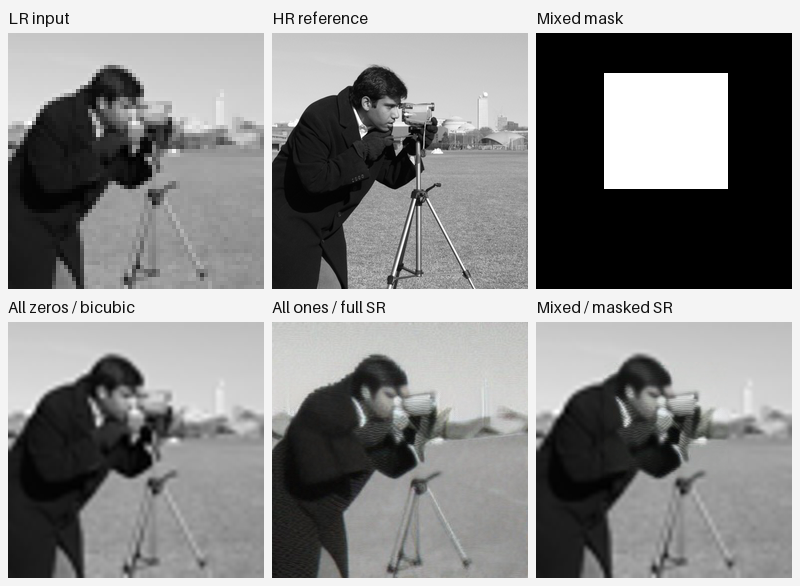
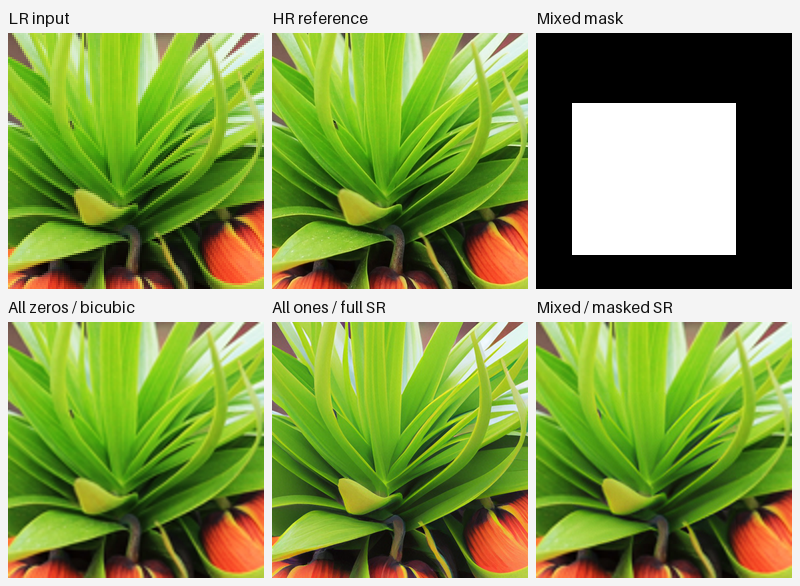
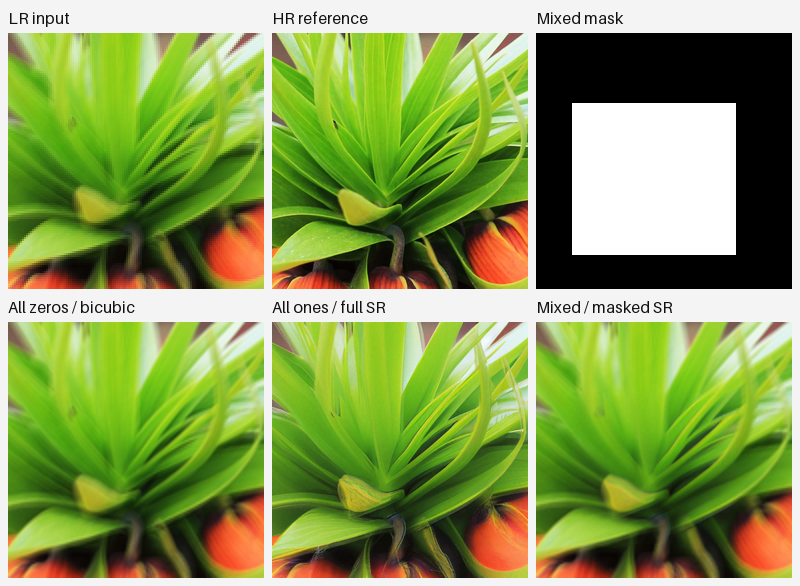
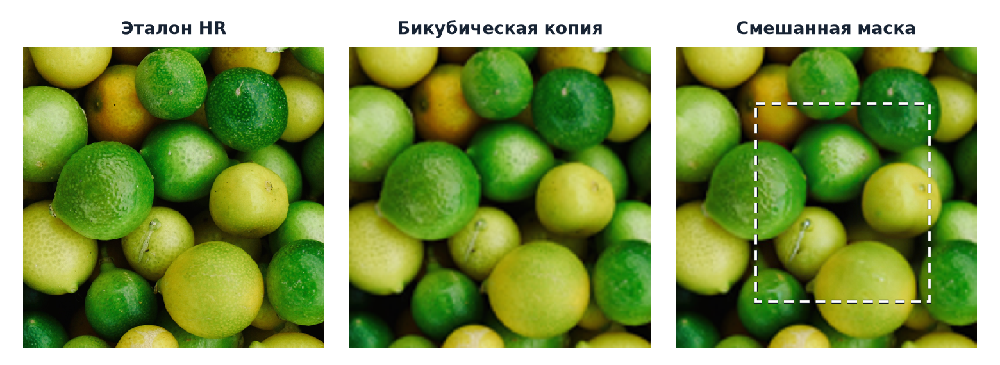

# ЛР3.2. Повышение разрешения по маске

Усложненный вариант – SR-inpainting. Программа принимает маленькое изображение и бинарную маску, увеличивает картинку в четыре раза по каждой стороне и восстанавливает детали в отмеченной области. Фон берется из бикубически увеличенной копии входа.

Для восстановления использована предобученная модель Stable Diffusion ×4 Upscaler. Алгоритм проверен на трех сценах DIV2K с тремя деградациями и тремя масками. Всего 27 прогонов.

---

## 1. Теоретическая база

### 1.1. Изображение и повышение разрешения

LR – маленькое входное изображение, HR – оригинал высокого разрешения. При переходе с `128 × 128` до `512 × 512` пикселей становится в 16 раз больше. Бикубическая интерполяция рассчитывает их значения по соседним пикселям входа. Например, тонкие полоски могут слиться в серое пятно при уменьшении. Интерполяция увеличит пятно, а диффузионная модель может по окружающим деталям восстановить правдоподобные полоски.

### 1.2. Прямой и обратный процесс диффузии

Прямой процесс смешивает чистое состояние с гауссовым шумом. Коэффициент `a_t` зависит от шага `t` и задает долю исходного сигнала.

```
z_t = sqrt(a_t) · z_0 + sqrt(1 − a_t) · ε
```

Здесь `z_0` – чистое состояние, `ε` – случайный шум. На поздних шагах доля шума выше. При обучении шум генерируется заранее, поэтому модель по зашумленному примеру учится оценивать величину, связанную с добавленным шумом.

При запуске обратный процесс начинается со случайного шума. Шаг за шагом он переходит к более чистому состоянию. Маленькое входное фото служит подсказкой о содержимом будущего результата. В SD ×4 к этой подсказке один раз добавляется шум с уровнем `noise_level`. Затем одна и та же подсказка используется на всех шагах.

### 1.3. Латент и VAE

Диффузия идет в компактной пространственной сетке – латенте. В SD ×4 изображению `512 × 512 × 3` соответствует латент `128 × 128 × 4`. В каждой ячейке записаны четыре выученных признака, по которым можно восстановить пиксели с учетом соседних ячеек.

VAE – вариационный автоэнкодер. Энкодер переводит картинку в распределение латентов, декодер переводит выбранный латент обратно в RGB. Для фона используется среднее распределения энкодера. Так одна и та же картинка при каждом кодировании дает один латент.

### 1.4. U-Net и DDIM

U-Net получает текущий латент, маленькое фото и номер шага. Сначала слои уменьшают пространственную сетку, чтобы учитывать более широкую область кадра. Затем сетка увеличивается обратно. Связи между слоями одинакового размера передают сведения о точном положении границ и мелких деталей.

Сеть SD ×4 предсказывает величину `v`, которая зависит от сигнала и шума. Шедулер DDIM использует это предсказание и текущее состояние, чтобы вычислить состояние для следующего шага. Весь цикл от случайного шума до готового латента называется сэмплингом.

### 1.5. Маска и фон

Фон – бикубически увеличенный вход. Маска имеет размер маленького изображения и совпадает с латентом по высоте и ширине. Одна ячейка маски задает выбор сразу для всех четырех каналов.

| Значение маски | На уровне латента после шага DDIM | После декодирования |
|---|---|---|
| 0 | латент бикубического фона с шумом нужного уровня | пиксели бикубического фона |
| 1 | латент, полученный на текущем шаге модели | пиксели результата модели |

На следующем шаге U-Net получает уже собранную сетку, поэтому фон участвует в восстановлении области возле границы. После декодирования маска увеличивается методом ближайшего соседа. Каждая ячейка становится блоком `4 × 4` из того же значения. Повторная сборка в RGB нужна для точного совпадения фона с бикубической копией, потому что кодирование и декодирование через VAE может изменить пиксели.

### 1.6. Метрики

**PSNR** – попиксельная точность. Для каждой точки и канала считается разность с эталоном, затем квадрат разности и среднее. Для RGB с диапазоном 0–255 формула такая.

```
PSNR = 10 · log10(255² / MSE)
```

Чем выше PSNR, тем меньше средний квадрат ошибки. При полном совпадении PSNR равен бесконечности.

**LPIPS** – расстояние между картами признаков двух изображений. Результат и эталон проходят через одну сеть AlexNet, затем сравниваются признаки с нескольких слоев. Чем меньше LPIPS, тем ближе картинки по этим признакам.

**CLIP-IQA** – оценка по одному изображению. CLIP переводит картинку и две фразы, `Good photo` и `Bad photo`, в векторы. Чем ближе вектор картинки к первой фразе относительно второй, тем выше оценка.

---

## 2. Описание разработанной системы

### 2.1. Структура

```text
lab3/
├── README.md
├── pyproject.toml, uv.lock   окружение uv
├── src/
│   ├── data.py               DIV2K, подготовка картинок и масок
│   ├── upscale.py            модель, сэмплинг с маской и сборка RGB
│   ├── metrics.py            PSNR, LPIPS и CLIP-IQA
│   └── run.py                прогоны, проверки и запись результатов
├── data/div2k/               архивы DIV2K, скачиваются при полном запуске
├── results/                  отдельная папка для каждого прогона
└── report/                   картинки, график, исходные метрики и настройки
```

Архивы и результаты каждого запуска хранятся локально. Для отчета используются файлы из `report/`, ссылки на них даны в разделе 3.

### 2.2. Функции

| Функция | Что делает |
|---|---|
| `load_model(device)` | загружает SD ×4 на выбранное устройство |
| `make_masks(size, box)` | создает маски из нулей, из единиц и с единицами внутри прямоугольника |
| `prepare_cases(data_dir)` | собирает пары LR и HR, по одной на сцену и деградацию |
| `upscale_masked(model, image, mask, *, seed, steps)` | выполняет апскейл с подстановкой фона по маске |
| `compose(result, background, mask)` | собирает итоговый RGB из результата модели и бикубического фона |
| `measure(result, reference, mask, lpips_model, clip_iqa_model)` | считает метрики по кадру и выбранной области |
| `run_experiment(mode, data_dir, out_dir, *, seed, steps, device)` | запускает один тест или весь эксперимент и сохраняет результаты |

### 2.3. Алгоритм

**До цикла сэмплинга.** Вход увеличивается бикубически, фон кодируется VAE. Для латента фона один раз генерируется шум. Генератор фона отдельный, поэтому начальный шум штатной модели воспроизводится с тем же `seed`.

**На каждом шаге.**

1. U-Net и DDIM вычисляют новое состояние латента.
2. Diffusers вызывает `replace_background()`. Фон зашумляется до уровня следующего шага. На последнем шаге берется чистый латент фона.
3. `torch.where` берет латент модели под единицами и латент фона под нулями. Сборка записывается в тот же тензор, который используется дальше в сэмплинге.

**После цикла.** VAE декодирует латент в RGB. Маска увеличивается до размера выходного изображения, и `compose()` подставляет пиксели бикубической копии на места нулей. Весовые коэффициенты модели загружаются из готового чекпойнта.

### 2.4. Параметры

| Параметр | `smoke` | `full` |
|---|---|---|
| размер входа | 64 × 64 | 128 × 128 |
| размер выхода | 256 × 256 | 512 × 512 |
| шагов DDIM | 4 | 25 |
| `seed` | 42 | 42 |
| `noise_level` | 20 | 20 |
| текстовая подсказка | пустая | пустая |
| `guidance_scale` | 1.0 | 1.0 |

В `smoke` достаточно четырех шагов для проверки правила подстановки. В `full` на всех сценах используются одинаковые параметры, чтобы сравнивать деградации и маски. [Настройки полного запуска](report/settings.json)

### 2.5. Тестовый набор

Для быстрой проверки используется [фотография камерамена из ЛР1](../lab1/data/camera_512.png). Для полного прогона берутся три сцены из валидационной выборки DIV2K.

| Сцена | Что видно на вырезке |
|---|---|
| 0801 | оперение птицы и камни |
| 0802 | цитрусовые и текстура кожуры |
| 0803 | зеленые листья и прожилки |

| Деградация | Откуда берется маленькое изображение |
|---|---|
| Bicubic ×4 | готовый LR из DIV2K, уменьшенный бикубическим методом |
| Unknown ×4 | готовый LR из DIV2K, уменьшенный неизвестным оператором |
| Real-ESRGAN | синтетический LR из HR, два цикла размытия, изменения размера, шума и JPEG по упрощенной схеме Real-ESRGAN |

Для каждой сцены из готовых LR берется одна и та же центральная вырезка. Чтобы вырезать соответствующий участок HR, координаты умножаются на 4. Одна смешанная маска используется для всех трех деградаций сцены.

### 2.6. Запуск

Прогоны выполнены на Windows с CUDA. Для текущего окружения нужны Windows x64, совместимая видеокарта NVIDIA, драйвер для CUDA 12.8 и `uv`. Используются Python 3.12, PyTorch 2.8 и Diffusers 0.35.2. Версии зависимостей зафиксированы в `uv.lock`.

Команды выполняются из папки `lab3` в клоне репозитория.

```powershell
uv sync --locked
uv run --locked python src/run.py smoke
uv run --locked python src/run.py full
```

Метрики считаются на CPU, их модели загружаются один раз за полный прогон.

---

## 3. Результаты работы и тестирования

### 3.1. Проверка трех масок

На камерамене проверены три случая. Обычный SD ×4 для сравнения запущен при тех же параметрах и том же seed. [Результаты проверок](report/checks.json)

| Маска | С чем сравнивается результат | Итог |
|---|---|---|
| все 0 | весь кадр с бикубической копией | попиксельное совпадение |
| все 1 | весь кадр со штатным SD ×4 | попиксельное совпадение |
| смешанная | пиксели вне маски с бикубической копией | попиксельное совпадение |



### 3.2. Сравнение трех деградаций

В таблицах приведены средние значения по трем сценам. Метрики рассчитаны по всему кадру. На всех листах сравнения показана сцена `0803`, чтобы сравнить три деградации на одном изображении. [Исходная таблица из 27 замеров](report/metrics.csv)

#### Bicubic ×4

| Маска | PSNR ↑, дБ | LPIPS ↓ | CLIP-IQA ↑ |
|---|---:|---:|---:|
| все 0 | 31.26 | 0.246 | 0.817 |
| все 1 | 27.59 | 0.160 | 0.880 |
| смешанная | 30.52 | 0.240 | 0.798 |



При обработке всего кадра средний PSNR снижается с 31.26 до 27.59 дБ. LPIPS улучшается с 0.246 до 0.160, CLIP-IQA растет с 0.817 до 0.880. Дорисованные детали выглядят более резкими, при этом растет попиксельная ошибка относительно оригинала.

#### Unknown ×4

| Маска | PSNR ↑, дБ | LPIPS ↓ | CLIP-IQA ↑ |
|---|---:|---:|---:|
| все 0 | 24.15 | 0.423 | 0.658 |
| все 1 | 23.46 | 0.398 | 0.700 |
| смешанная | 24.07 | 0.422 | 0.648 |



Результат зависит от сцены. На `0803` полный апскейл делает края и прожилки листьев заметнее. LPIPS снижается с 0.416 до 0.257, CLIP-IQA растет с 0.696 до 0.969, PSNR падает с 23.38 до 22.03 дБ. На `0801` при тех же настройках все три метрики ухудшаются относительно бикубической копии.

#### Real-ESRGAN

| Маска | PSNR ↑, дБ | LPIPS ↓ | CLIP-IQA ↑ |
|---|---:|---:|---:|
| все 0 | 27.56 | 0.424 | 0.637 |
| все 1 | 27.16 | 0.249 | 0.608 |
| смешанная | 27.51 | 0.407 | 0.559 |


Обработка всего кадра дает наибольший средний выигрыш по LPIPS среди трех деградаций, с 0.424 до 0.249. Средняя оценка CLIP-IQA при этом снижается с 0.637 до 0.608.


### 3.3. Выбранный участок и граница маски

На правом изображении `0802 / bicubic` пунктиром обведен весь прямоугольник смешанной маски. Пунктир нанесен на иллюстрацию для ориентира. Внутри прямоугольника находятся пиксели восстановленного участка, снаружи – бикубический фон. Сравнение сохраненных PNG показало **0 измененных пикселей вне маски** во всех девяти случаях полного прогона.



В `metrics.csv` есть `psnr_mask` по выбранным пикселям и `lpips_crop` по прямоугольной вырезке. У нулевой маски эти поля пустые. Для проверки качества внутри маски PSNR дополнительно посчитан по одной и той же области смешанной маски у бикубической копии и у результата. В каждой строке среднее по трем сценам. Разница посчитана до округления.

| Деградация | PSNR бикубической копии, дБ | PSNR смешанного результата, дБ |
|---|---:|---:|
| Bicubic ×4 | 30.48 | 28.90 |
| Unknown ×4 | 23.76 | 23.57 |
| Real-ESRGAN | 27.17 | 27.04 |

PSNR смешанного результата внутри маски оказался ниже во всех девяти сравнениях, в среднем на 0.63 дБ. LPIPS между методами в этом отчете сравнивается по всему кадру, значения `lpips_crop` для бикубической копии в исходной таблице нет.

### 3.4. Закономерности

Средние по каждой маске. По девять результатов на строку.

| Маска | PSNR ↑, дБ | LPIPS ↓ | CLIP-IQA ↑ |
|---|---:|---:|---:|
| все 0 | **27.66** | 0.364 | 0.704 |
| все 1 | 26.07 | **0.269** | **0.729** |
| смешанная | 27.37 | 0.356 | 0.668 |

**Лучший PSNR у бикубической копии.** В каждом из девяти примеров она ближе к эталону по пикселям, чем оба диффузионных результата.

**Полный апскейл чаще улучшает визуальное сходство.** LPIPS ниже бикубической копии в 7 из 9 случаев для маски из единиц. CLIP-IQA выше в 5 из 9 случаев. Рост CLIP-IQA на листьях и падение PSNR на том же примере показывают, что метрики реагируют на разные свойства изображения.

**Смешанная маска сохраняет фон.** По всему кадру ее PSNR в среднем на 0.29 дБ ниже бикубической копии, а LPIPS улучшается в 6 из 9 случаев. CLIP-IQA растет только в 2 из 9. Внутри выделенной области эффект виден на отдельных текстурах, а PSNR показывает рост попиксельной ошибки.

---

## 4. Выводы

1. Подстановка фона после каждого шага DDIM позволяет локализовать восстановление деталей по бинарной маске.
2. Итоговая сборка в RGB сохраняет фон точно. В девяти случаях полного прогона снаружи смешанной маски не изменился ни один пиксель относительно бикубической копии.
3. Обработка всего кадра улучшила LPIPS в 7 из 9 случаев, а PSNR снизился во всех девяти. Дорисованные детали могут выглядеть естественно и расходиться с оригиналом по пикселям.
4. У смешанной маски изменения ограничены выбранной областью. Средний PSNR внутри нее на 0.63 дБ ниже бикубической копии на тех же пикселях.
5. На `Unknown ×4` результат зависит от сцены. На листьях выросла оценка CLIP-IQA, на оперении она упала.

---

## 5. Справочные материалы

1. Hugging Face. [Diffusers — повышение разрешения с SD ×4](https://huggingface.co/docs/diffusers/api/pipelines/stable_diffusion/upscale)
2. ETH Zurich. [DIV2K — набор изображений и варианты деградации](https://data.vision.ee.ethz.ch/cvl/DIV2K/)
3. TorchMetrics. [CLIP-IQA — оценка качества по одному изображению](https://lightning.ai/docs/torchmetrics/stable/multimodal/clip_iqa)
