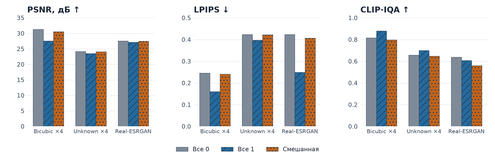

# ЛР3.2. Повышение разрешения по маске

Программа увеличивает маленькое фото в четыре раза по ширине и высоте. Внутри области, заданной маской, она восстанавливает детали с помощью готовой модели **Stable Diffusion ×4 Upscaler**. Для остальной части кадра программа берет пиксели из бикубически увеличенной копии входа.

Проверка выполнена на трех сценах набора DIV2K с тремя способами получения маленького входа и тремя масками. Всего 27 прогонов.

---

## 1. Теоретическая база

### 1.1. Изображение и повышение разрешения

- **LR – Low Resolution, низкое разрешение.** Маленькое фото, которое получает программа.
- **HR – High Resolution, высокое разрешение.** Оригинал, с которым сравнивается итоговая картинка.
- **SR – Super-Resolution, сверхразрешение.** Восстановление деталей при увеличении фото. *Inpainting* – дорисовывание выбранной области. Вариант **SR-inpainting** объединяет эти две задачи.
- **SD – Stable Diffusion, «стабильная диффузия».** Название семейства моделей. **SD ×4** в работе увеличивает каждую сторону изображения в четыре раза.

В полном эксперименте картинка `128 × 128` увеличивается до `512 × 512`. Пикселей становится в 16 раз больше. **Бикубическая интерполяция** рассчитывает цвет новых пикселей по соседним значениям и служит точкой отсчета. Например, если при уменьшении тонкие полоски слились в пятно, обычное увеличение растянет это пятно. Модель может по окружению дорисовать правдоподобные полоски. Их точность можно проверить по оригиналу.

### 1.2. Прямой и обратный процесс диффузии

При прямом процессе к чистому состоянию постепенно добавляется гауссов шум.

```
z_t = sqrt(a_t) · z_0 + sqrt(1 − a_t) · ε
```

Здесь `z_0` – чистое состояние, `z_t` – состояние на шаге `t`, `ε` – случайный шум. Коэффициент `a_t` определяет, сколько исходного сигнала сохраняется. На более поздних шагах прямого процесса шума больше. При обучении модель видит такие зашумленные примеры и учится делать предсказание, связанное с шумом.

При запуске готовой модели процесс идет в обратную сторону. Рабочий латент начинается со случайного шума и шаг за шагом приближается к картинке. Маленькое фото показывает модели, что где находится. К нему один раз добавляется шум с уровнем `noise_level`. Дальше на каждом шаге используется одна и та же подсказка.

### 1.3. Латент и VAE

**RGB – Red, Green, Blue, красный, зеленый и синий.** Цвет пикселя задается тремя числами. Поэтому изображение имеет размер `512 × 512 × 3`.

**Латент** – компактная сетка чисел, в которой модель хранит сведения об изображении. У нашей модели это `128 × 128 × 4`. Четыре числа в каждой клетке – внутренние признаки, которые модель использует вместе с соседними клетками при восстановлении изображения. Число каналов задает архитектура. В этой сетке в 12 раз меньше чисел, чем в цветном изображении.

**VAE – Variational Autoencoder, вариационный автоэнкодер.** Энкодер переводит картинку в латент, а декодер переводит латент обратно в цвета. Для фона берем средние значения, которые выдает энкодер. Так одна и та же бикубическая копия дает один и тот же латент. Фон кодируется один раз до цикла, а готовое состояние декодируется один раз после цикла.

### 1.4. U-Net и DDIM

**U-Net** (*U-shaped network*, нейросеть в форме буквы U) называется так из-за формы схемы. С одной стороны сетка уменьшается `128 → 64 → 32 → 16`, с другой увеличивается обратно до `128`. Уменьшение помогает сети учитывать более широкую область кадра. Связи между блоками одинакового размера передают более подробные сведения о том, где проходят границы. Например, при восстановлении листа нужны и его общая форма, и точное положение края.

На одном шаге U-Net получает четыре канала рабочего латента и три цветовых канала маленького фото. Сеть также знает номер шага. На выходе она возвращает четыре канала предсказания `v`, в котором есть информация о сигнале и шуме. **DDIM – Denoising Diffusion Implicit Models, неявные диффузионные модели с удалением шума.** В программе это правило, по которому из предсказания и текущего латента рассчитывается состояние для следующего шага. Компонент, который выполняет этот расчет, называется *шедулером*. Весь путь от случайного шума до готового латента называется *сэмплингом*.

### 1.5. Маска и фон

Фон – бикубически увеличенное маленькое фото. Сама маска состоит из нулей и единиц. По ширине и высоте она совпадает с рабочим латентом. Одна клетка маски действует на все четыре канала.

| Значение маски | На уровне латента после шага DDIM | После декодирования |
|---|---|---|
| 0 | латент бикубического фона с шумом нужного уровня | пиксели бикубического фона |
| 1 | латент, полученный на текущем шаге модели | пиксели результата модели |

После каждого шага фон подставляется в латент, чтобы на следующем шаге модель учитывала окружение выбранной области. После декодирования маска увеличивается методом ближайшего соседа. Каждая клетка становится блоком `4 × 4` с тем же значением. На этом этапе под нулями берем пиксели прямо из бикубической копии. Это сохраняет фон точно, поскольку перевод через VAE может немного изменить цвета.

### 1.6. Метрики

**PSNR – Peak Signal-to-Noise Ratio, пиковое отношение сигнала к шуму.** Сравниваем пиксели результата и оригинала в одинаковых координатах. Каждую разность возводим в квадрат и берем среднее. Получаем **MSE – Mean Squared Error, среднеквадратичную ошибку**. Для цветов с диапазоном от 0 до 255 формула имеет вид

```
PSNR = 10 · log10(255² / MSE)
```

Чем выше PSNR в децибелах (**дБ**, по-английски *decibel*, **dB**), тем меньше ошибка. При полном совпадении PSNR равен бесконечности.

**LPIPS – Learned Perceptual Image Patch Similarity, оценка воспринимаемого сходства участков изображения с помощью обученной сети.** Результат и оригинал проходят через одну сеть AlexNet. Она выделяет признаки, например границы и текстуры. Чем меньше расстояние между этими признаками, тем ниже LPIPS и тем ближе картинки по этой оценке.

**CLIP-IQA – CLIP Image Quality Assessment, оценка качества изображения с помощью CLIP.** **CLIP – Contrastive Language-Image Pre-Training, контрастивное предобучение на парах текста и изображения.** Здесь метрика получает только результат. Она сравнивает его с фразами «хорошее фото» (`Good photo`) и «плохое фото» (`Bad photo`). Чем ближе результат к первой фразе относительно второй, тем выше оценка.

Например, модель дорисовала четкую прожилку листа чуть в стороне от ее положения на оригинале. Она может выглядеть естественно, хотя PSNR снизится из-за ошибки в конкретных координатах.

---

## 2. Описание разработанной системы

### 2.1. Структура

```text
lab3/
├── README.md
├── pyproject.toml, uv.lock   окружение uv
├── src/
│   ├── data.py               DIV2K, подготовка картинок и масок
│   ├── upscale.py            модель, сэмплинг с маской и сборка RGB
│   ├── metrics.py            PSNR, LPIPS и CLIP-IQA
│   └── run.py                прогоны, проверки и запись результатов
├── data/div2k/               архивы DIV2K, скачиваются при полном запуске
├── results/                  отдельная папка для каждого прогона
└── report/                   картинки, график, исходные метрики и настройки
```

Архивы и полные результаты каждого запуска хранятся локально. Для отчета используются файлы из `report/`. Рисунки сохранены в **PNG – Portable Network Graphics, переносимая сетевая графика**. Это формат изображений со сжатием без потерь. Метрики записаны в **CSV – Comma-Separated Values, значения, разделенные запятыми**. Настройки и проверки сохранены в **JSON – JavaScript Object Notation, текстовом формате записи объектов JavaScript**.

### 2.2. Функции

| Функция | Что делает |
|---|---|
| `load_model(device)` | загружает SD ×4 на выбранное устройство |
| `make_masks(size, box)` | создает маски из нулей, из единиц и с единицами внутри прямоугольника |
| `degrade_realesrgan(image, seed)` | дважды уменьшает и портит оригинал, затем доводит вход до нужного размера |
| `prepare_cases(data_dir)` | собирает для каждой сцены три маленьких входа, общий оригинал и маски |
| `upscale_masked(model, image, mask, *, seed, steps)` | выполняет апскейл с подстановкой фона по маске |
| `compose(result, background, mask)` | собирает итоговый RGB из результата модели и бикубического фона |
| `measure(result, reference, mask, lpips_model, clip_iqa_model)` | считает метрики по кадру и выбранной области |
| `run_experiment(mode, data_dir, out_dir, *, seed, steps, device)` | запускает один тест или весь эксперимент и сохраняет результаты |

### 2.3. Алгоритм

1. **Подготовка фона.** Функция `bicubic()` увеличивает маленькое фото через Pillow. Затем энкодер VAE переводит фон в латент. Для него один раз генерируется свой шум. Отдельный генератор позволяет сохранить одинаковый начальный шум модели при сравнении масок.
2. **Обработка.** U-Net и DDIM вычисляют следующее состояние рабочего латента. Затем Diffusers вызывает `replace_background()`. Эта функция добавляет к латенту фона шум нужного уровня для следующего шага. В самом конце берет чистый латент фона. Операция `torch.where` оставляет под единицами результат шага, а под нулями подставляет фон.
3. **Сборка.** VAE переводит готовый латент в цветное изображение. Функция `compose()` берет из него пиксели внутри маски и подставляет бикубические пиксели снаружи. Поэтому маска из нулей дает бикубическую копию, из единиц – результат по всему кадру, смешанная – обработку в области прямоугольника.

Модель загружается с готовыми весами. Во время работы меняется тензор латента, то есть сетка чисел текущего изображения. Веса модели остаются прежними. Расчет идет в `torch.inference_mode()` без вычисления градиентов.

### 2.4. Параметры

| Параметр | `smoke` | `full` |
|---|---|---|
| размер входа | 64 × 64 | 128 × 128 |
| размер выхода | 256 × 256 | 512 × 512 |
| шагов DDIM | 4 | 25 |
| `seed` | 42 | 42 |
| `noise_level` | 20 | 20 |
| текстовая подсказка | пустая | пустая |
| `guidance_scale` | 1.0 | 1.0 |

`smoke` – быстрый тест на камерамене, `full` – полный эксперимент. `seed` задает начальное число генератора случайных чисел. Одинаковый `seed` позволяет сравнивать маски с одинаковым стартовым шумом.

`noise_level = 20` – стандартное значение для SD ×4. Этот параметр отвечает за уровень шума, который один раз добавляется к маленькой подсказке. `guidance_scale = 1.0` отключает дополнительное усиление влияния текста. Настройки полного прогона одинаковы для всех сцен. [Настройки полного запуска](report/settings.json)

### 2.5. Тестовый набор

Для быстрой проверки используется [фотография камерамена из ЛР1](../lab1/data/camera_512.png). Для полного прогона берутся три сцены из проверочной части **DIV2K – DIVerse 2K resolution high quality images**, набора разнообразных изображений высокого качества с разрешением порядка 2000 пикселей по длинной стороне.

| Сцена | Что видно на вырезке |
|---|---|
| 0801 | оперение птицы и камни |
| 0802 | цитрусовые и текстура кожуры |
| 0803 | зеленые листья и прожилки |

Деградация здесь означает способ получения маленького входа из большого оригинала.

| Деградация | Откуда берется маленькое изображение |
|---|---|
| Bicubic ×4 | готовый LR из DIV2K, уменьшенный бикубическим методом |
| Unknown ×4 | готовый LR из DIV2K, полученный размытием и уменьшением по неизвестному для участников правилу |
| Real-ESRGAN | синтетический LR из HR, два цикла размытия, уменьшения размера, добавления шума и сжатия JPEG |

В названии **Real-ESRGAN** часть **ESRGAN – Enhanced Super-Resolution Generative Adversarial Networks**, улучшенные генеративно-состязательные сети для сверхразрешения. Из этой работы взята упрощенная схема искажения входа. Для сжатия используется **JPEG – Joint Photographic Experts Group**, формат, названный в честь Объединенной группы экспертов по фотографии. На каждом из двух проходов фото сохраняется во временный JPEG и сразу читается обратно. В конце вход доводится до `128 × 128`.

Для каждой сцены из готовых LR берется одна и та же центральная вырезка. Координаты умножаются на четыре, чтобы вырезать соответствующий участок HR. Этот участок используется как оригинал для всех трех входов. Маски у этих входов общие. В итоге получаем **3 сцены × 3 входа × 3 маски = 27 результатов**.

### 2.6. Запуск

Прогоны выполнены на Windows с **CUDA – Compute Unified Device Architecture**, унифицированной архитектурой вычислительных устройств NVIDIA. Она позволяет выполнять расчеты модели на видеокарте. Для текущего окружения нужны Windows x64, совместимая видеокарта NVIDIA, драйвер для CUDA 12.8 и `uv`. Используются Python 3.12, PyTorch 2.8 и Diffusers 0.35.2. Версии зависимостей зафиксированы в `uv.lock`.

Команды выполняются из папки `lab3` в клоне репозитория.

```powershell
uv sync --locked
uv run --locked python src/run.py smoke
uv run --locked python src/run.py full
```

Метрики считаются на **CPU – Central Processing Unit, центральном процессоре**. Их модели загружаются один раз за полный прогон.

---

## 3. Результаты работы и тестирования

### 3.1. Проверка трех масок

На камерамене проверены три случая. Обычный SD ×4 для сравнения запущен при тех же параметрах и том же seed. [Результаты проверок](report/checks.json)

| Маска | С чем сравнивается результат | Итог |
|---|---|---|
| все 0 | весь кадр с бикубической копией | попиксельное совпадение |
| все 1 | весь кадр со штатным SD ×4 | попиксельное совпадение |
| смешанная | пиксели вне маски с бикубической копией | попиксельное совпадение |


В верхнем ряду слева маленький вход с крупными пикселями, в центре четкий оригинал, справа прямоугольник маски. Внизу слева бикубическая копия сглаживает края. В центре модель добавляет текстуру на одежде и на фоне. Справа изменения заметнее у лица и камеры. Поле и низ штатива за пределами маски выглядят как в бикубической копии.

### 3.2. Сравнение трех деградаций

В каждой таблице три строки по маскам. Числа в строках – средние по птице, цитрусовым и листьям, рассчитанные по всему кадру. На всех трех рисунках показана одна сцена с листьями `0803`. Сверху слева направо идут маленькое фото, оригинал и маска. Снизу – бикубическая копия, обработка всего кадра и результат со смешанной маской. [Исходная таблица из 27 замеров](report/metrics.csv)

#### Bicubic ×4

| Маска | PSNR ↑, дБ | LPIPS ↓ | CLIP-IQA ↑ |
|---|---:|---:|---:|
| все 0 | 31.26 | 0.246 | 0.817 |
| все 1 | 27.59 | 0.160 | 0.880 |
| смешанная | 30.52 | 0.240 | 0.798 |


На длинных листьях внизу по центру границы четче, чем в бикубической копии слева. Если сравнить их с оригиналом сверху, часть тонких линий проходит иначе. При обработке всего кадра средний PSNR снижается с 31.26 до 27.59 дБ. LPIPS улучшается с 0.246 до 0.160, CLIP-IQA растет с 0.817 до 0.880. У смешанной маски большая часть кадра остается прежней, и PSNR ближе к бикубической копии – 30.52 дБ.

#### Unknown ×4

| Маска | PSNR ↑, дБ | LPIPS ↓ | CLIP-IQA ↑ |
|---|---:|---:|---:|
| все 0 | 24.15 | 0.423 | 0.658 |
| все 1 | 23.46 | 0.398 | 0.700 |
| смешанная | 24.07 | 0.422 | 0.648 |


В бикубической копии листья в центре сливаются. После обработки всего кадра их края легче различить, а на маленьком желтом листе у основания появляется новая текстура. На этом примере LPIPS снижается с 0.416 до 0.257, CLIP-IQA растет с 0.696 до 0.969, PSNR падает с 23.38 до 22.03 дБ. В среднем выигрыш по LPIPS меньше, с 0.423 до 0.398. На сцене с птицей `0801` при тех же настройках все три метрики ухудшаются относительно бикубической копии.

#### Real-ESRGAN

| Маска | PSNR ↑, дБ | LPIPS ↓ | CLIP-IQA ↑ |
|---|---:|---:|---:|
| все 0 | 27.56 | 0.424 | 0.637 |
| все 1 | 27.16 | 0.249 | 0.608 |
| смешанная | 27.51 | 0.407 | 0.559 |


В бикубической копии заметна зернистость. После обработки всего кадра длинные листья выглядят более гладкими, а их края лучше различимы. Эта деградация дает самый большой средний выигрыш по LPIPS, с 0.424 до 0.249. Признаки результата приблизились к оригиналу, а отдельная оценка внешнего вида CLIP-IQA снизилась с 0.637 до 0.608.



На диаграмме те же средние, что в таблицах. Серый – бикубическая копия, синий – обработка всего кадра, оранжевый – смешанная маска. Слева самый высокий PSNR у серых столбцов во всех трех группах. В центре самые низкие значения LPIPS у синих столбцов, и здесь меньшее значение лучше. Справа лучший CLIP-IQA у синего столбца для Bicubic и Unknown и у серого для Real-ESRGAN.

### 3.3. Выбранный участок и граница маски


Слева оригинал с мелкими порами кожуры, в центре бикубическая копия, справа смешанный результат. Пунктир добавлен на иллюстрацию и показывает всю область обработки. У большого зеленого лайма на левой границе прямоугольника бороздки внутри маски местами заметнее. Снаружи правая панель в точности совпадает со средней. Проверка сохраненных PNG показала **0 измененных пикселей вне маски** во всех девяти случаях полного прогона.

Если взять окно из готового результата с маской из единиц и вставить его в бикубическую копию, детали внутри окна совпадут с результатом по всему кадру. В нашей смешанной маске фон подставляется уже после каждого шага. Поэтому на следующем шаге модель видит другое окружение и может дорисовать детали внутри окна иначе. На сравнении с листьями смешанная маска занимает около 38 % кадра. Остальные 62 % совпадают с бикубической копией, а внутри изменения местами заметны только на тонких линиях и текстурах. Поэтому две картинки в целом выглядят похоже.

В `metrics.csv` есть `psnr_mask` по выбранным пикселям и `lpips_crop` по прямоугольной вырезке. У нулевой маски эти поля пустые. Для проверки качества внутри маски PSNR дополнительно посчитан по одной и той же области смешанной маски у бикубической копии и у результата. В каждой строке среднее по трем сценам. Разница посчитана до округления.

| Деградация | PSNR бикубической копии, дБ | PSNR смешанного результата, дБ |
|---|---:|---:|
| Bicubic ×4 | 30.48 | 28.90 |
| Unknown ×4 | 23.76 | 23.57 |
| Real-ESRGAN | 27.17 | 27.04 |

PSNR внутри маски снизился во всех девяти сравнениях, в среднем на 0.63 дБ. По всему кадру снижение меньше, 0.29 дБ, поскольку снаружи маски ошибка осталась прежней. LPIPS между методами в отчете сравнивается по всему кадру, значения `lpips_crop` для бикубической копии в исходной таблице нет.

### 3.4. Закономерности

Средние по каждой маске. По девять результатов на строку.

| Маска | PSNR ↑, дБ | LPIPS ↓ | CLIP-IQA ↑ |
|---|---:|---:|---:|
| все 0 | **27.66** | 0.364 | 0.704 |
| все 1 | 26.07 | **0.269** | **0.729** |
| смешанная | 27.37 | 0.356 | 0.668 |

**Лучший PSNR у бикубической копии.** В каждом из девяти примеров она ближе к эталону по пикселям, чем оба диффузионных результата.

**Полный апскейл чаще улучшает визуальное сходство.** LPIPS ниже бикубической копии в 7 из 9 случаев для маски из единиц. CLIP-IQA выше в 5 из 9 случаев. Рост CLIP-IQA на листьях и падение PSNR на том же примере показывают, что метрики реагируют на разные свойства изображения.

**Смешанная маска сохраняет фон.** По всему кадру ее PSNR в среднем на 0.29 дБ ниже бикубической копии, а LPIPS улучшается в 6 из 9 случаев. CLIP-IQA растет только в 2 из 9. Внутри выделенной области эффект виден на отдельных текстурах, а PSNR показывает рост попиксельной ошибки.

---

## 4. Выводы

Смешанная маска ограничивает обработку выбранным прямоугольником. Во всех девяти примерах фон сохранился пиксель в пиксель. Внутри маски некоторые текстуры стали заметнее, но средняя точность по пикселям снизилась. Полная обработка чаще приближала картинку к оригиналу по LPIPS. Пример с листьями и птицей при одинаковой деградации Unknown показывает, что эффект зависит и от самой сцены. Поэтому результат оценивается по нескольким метрикам и по изображениям.

---

## 5. Справочные материалы

1. Hugging Face. [Diffusers — повышение разрешения с SD ×4](https://huggingface.co/docs/diffusers/api/pipelines/stable_diffusion/upscale)
2. ETH Zurich. [DIV2K — набор изображений и варианты деградации](https://data.vision.ee.ethz.ch/cvl/DIV2K/)
3. TorchMetrics. [CLIP-IQA — оценка качества по одному изображению](https://lightning.ai/docs/torchmetrics/stable/multimodal/clip_iqa)
